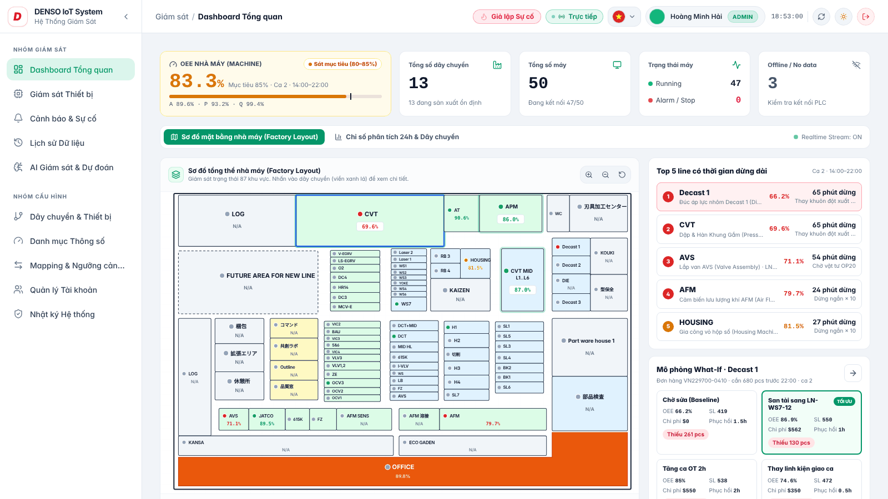
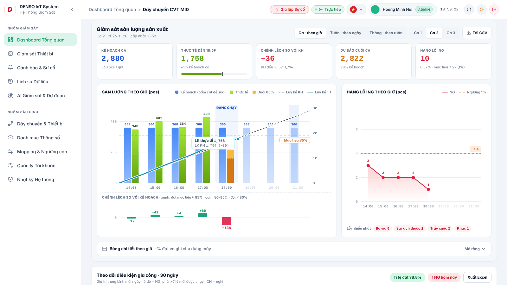
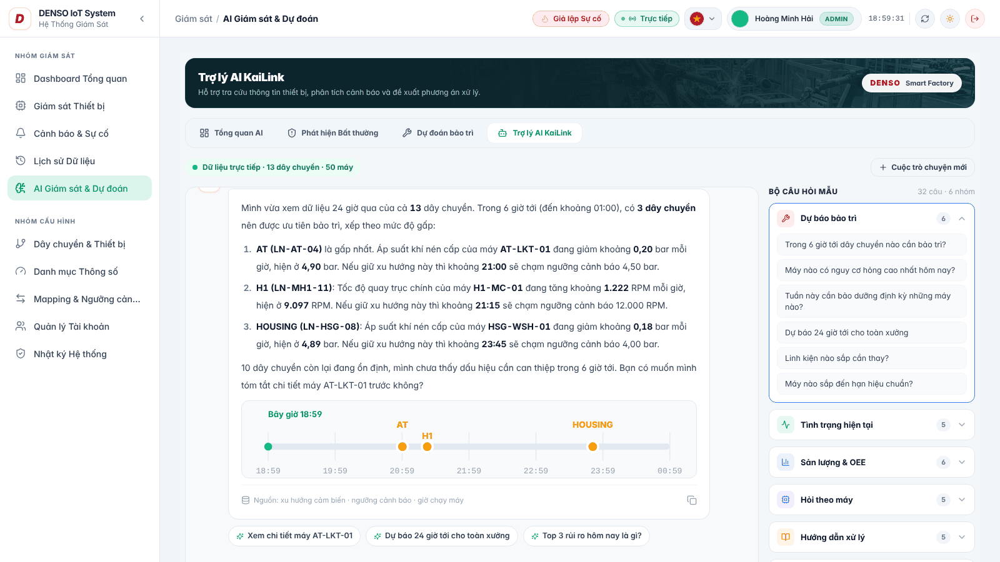

<div align="center">

# DENSO IoT Monitoring System – KaiLink

**Nền tảng giám sát nhà máy thông minh theo thời gian thực** — sản lượng, OEE, dừng máy, tình trạng thiết bị và đề xuất phương án "cứu đơn hàng".

Bài dự thi **DENSO Hackathon** · Nhóm **OptiMax**

[](https://denso-iot-monitoring-on6l.vercel.app)
[](https://denso-iot-monitoring.onrender.com/api/health)
[](https://github.com/HoangTuan1301/denso-iot-monitoring/releases)




</div>

<table>
  <tr>
    <td width="50%"></td>
    <td width="50%"></td>
  </tr>
  <tr>
    <td align="center"><sub>Sản lượng theo giờ: kế hoạch – thực tế – lũy kế – dự báo cuối ca</sub></td>
    <td align="center"><sub>Trợ lý AI KaiLink: trả lời từ dữ liệu trực tiếp của nhà máy</sub></td>
  </tr>
</table>

- **Web demo:** https://denso-iot-monitoring-on6l.vercel.app
- **API (backend):** https://denso-iot-monitoring.onrender.com — kiểm tra nhanh tại `/api/health`
- **Ngôn ngữ giao diện:** Tiếng Việt · English · 日本語
- **Thiết bị:** máy tính, máy tính bảng và điện thoại (menu dạng trượt trên màn hình < 1024px)

> ⚠️ Backend chạy gói miễn phí của Render nên **ngủ sau ~15 phút không dùng**. Lần mở đầu tiên có thể mất 30–60 giây. Nhóm dùng cron-job.org gọi `/api/health` định kỳ để giữ server thức.

---

## 1. Chức năng chính

### 1.1 Giám sát (màn hình chính)

| Màn hình | Nội dung |
|---|---|
| **Dashboard tổng quan** | KPI nhà máy (OEE = A × P × Q, số dây chuyền, số máy, trạng thái, máy offline) · **Sơ đồ mặt bằng nhà máy** 87 khu vực, tô màu theo *trạng thái sản xuất* · **Top 5 dây chuyền dừng dài nhất** trong ca · **Mô phỏng What-If** (Chờ sửa / San tải sang line khác / Tăng ca OT / Thay linh kiện giao ca) · **Thác tổn thất** sản lượng · khuyến nghị và xuất báo cáo |
| **Chi tiết dây chuyền** | KPI ca (OEE, dừng ngắn チョコ停, dừng dài ドカ停, sản lượng) · sơ đồ dây chuyền 2D/3D, bấm vào máy để mở chi tiết · **Giám sát sản lượng** theo giờ (kế hoạch – thực tế – dự báo cuối ca, chọn Ca 1/2/3) · **Bảng điều kiện gia công 30 ngày** (đánh dấu ô ngoài quy cách, xuất Excel) |
| **Chi tiết máy** | Trạng thái, thông số realtime, thông tin kỹ thuật · **Check sheet đầu/cuối ca** nằm ngay trong trang (ghi nhận, tự chấm OK/NG theo ngưỡng, xuất CSV) · **Tài liệu máy** (bản vẽ, chương trình, khác — tải lên/tải xuống) · **Dữ liệu Unipulse** (xem sóng lực ép) · nút **Tải CSV**: sinh file ngay lúc bấm theo đúng định dạng thiết bị thật — máy ép/dập → file sóng **Unipulse F381**, máy khác → file log vị trí **Keyence KV** (POS1–POS3) của hôm nay |
| **Giám sát thiết bị** | Danh sách máy dạng thẻ/bảng, lọc theo dây chuyền, trạng thái, nguồn dữ liệu, mã QR |
| **Cảnh báo & sự cố** | Nhật ký cảnh báo, quy trình 3 bước *Chờ tiếp nhận → Đang xử lý → Đã giải quyết*, xuất CSV/Excel |
| **Lịch sử dữ liệu** | Tra cứu telemetry theo ca/ngày/giờ/máy (mặc định 3 ngày gần nhất, nút chọn nhanh Hôm nay / 3 / 7 / 30 ngày), lọc theo mức cảnh báo, xuất Excel · CSV · JSON |
| **AI giám sát & dự đoán** | Tổng quan sức khỏe thiết bị, phát hiện bất thường (Z-score), dự đoán bảo trì, trợ lý AI KaiLink — **chạy bằng kịch bản mô phỏng**, không gọi mô hình AI bên ngoài |

### 1.2 Cấu hình (ADMIN / MAINTENANCE)

Dây chuyền & thiết bị (gán trạm PLC) · Danh mục thông số · Mapping & ngưỡng cảnh báo, lịch thu thập · Quản lý tài khoản (chỉ ADMIN) · Nhật ký hệ thống (audit log).

### 1.3 Phân quyền

| Vai trò | Quyền |
|---|---|
| `ADMIN` | Toàn quyền, quản lý tài khoản, đổi cài đặt sản xuất |
| `MAINTENANCE` | Cấu hình dây chuyền/thông số, tải lên/xóa tài liệu máy, xem audit log |
| `OPERATOR` | Xem giám sát, ghi nhận check sheet, xử lý cảnh báo |

### 1.4 Dữ liệu mô phỏng — cần biết khi demo

Dữ liệu **sản xuất** (sản lượng, OEE, dừng máy, What-If, điều kiện gia công 30 ngày, Unipulse) được **mô phỏng tất định** ở backend (`server/production/ProductionSimulator.js`): cùng dây chuyền + ngày + ca luôn ra cùng kết quả, theo giờ Việt Nam (UTC+7). Mọi phản hồi loại này có `simulated: true`.

- **5 dây chuyền có vấn đề mỗi ngày** (đổi theo ngày): có dừng dài, OEE thấp (đỏ/cam); các dây chuyền khác chạy ổn định (OEE ≈ 87–93 %, xanh). Màu trạng thái theo OEE: ≥ 85 % xanh · 80–85 % cam · < 80 % đỏ.
- **Sản lượng theo giờ:** kế hoạch chia đều; thực tế có họp đầu ca, giải lao, ăn ca (nghỉ có kế hoạch, không tính vào OEE) và dao động ±4 % mỗi giờ. Kế hoạch từng giờ sửa được bằng cách bấm vào cột (ADMIN/MAINTENANCE).
- **Giả lập sự cố** (nút trên thanh tiêu đề, ADMIN): chọn một máy đang chạy tốt, chuyển sang báo động; **Khôi phục sự cố** để trở lại. Nút **Trực tiếp** bật/tắt tự làm mới dữ liệu.
- **Lịch sử telemetry demo** (`server/production/historySimulator.js`): 10 phút ghi 1 mẫu cho mọi thông số, tự bù 7 ngày khi khởi động, có các đợt cảnh báo/nguy hiểm theo các dây chuyền có vấn đề và theo sự cố giả lập. Tắt bằng `HISTORY_SIM=false`.
- **Năm tài chính:** nhãn năm/kỳ và tên file xuất dùng năm tài chính DENSO (bắt đầu 1/4, VD tháng 11/2026 = FY27).

- Ca làm việc: **Ca 1** 06:00–14:00 · **Ca 2** 14:00–22:00 · **Ca 3** 22:00–06:00.
- Ngưỡng phân biệt dừng ngắn / dừng dài mặc định **10 phút**, lưu trong bảng `app_settings`, đổi qua `PUT /api/production/settings` (ADMIN).
- Có **13 dây chuyền** trong CSDL: 3 dây chuyền gốc (`LN-PRS-01`, `LN-PNT-02`, `LN-ASM-03`) và **10 dây chuyền mở rộng** gắn với các ô trên sơ đồ nhà máy: AT (`LN-AT-04`), AFM (`LN-AFM-05`), JATCO (`LN-JAT-06`), AVS (`LN-AVS-07`), HOUSING (`LN-HSG-08`), Decast 1 (`LN-DCS-09`), DCT (`LN-DCT-10`), H1 (`LN-MH1-11`), WS7 (`LN-WS7-12`), OCV3 (`LN-OCV-13`) — tổng 37 máy, kèm thông số, ngưỡng và lịch sử mẫu.
  - Cấu hình: `server/production/expansionLines.js` (CSDL + mô phỏng) và `src/config/expansionLines.ts` (sơ đồ băng chuyền, ảnh máy `public/images/machines/cutout/N01–N16.webp`).
  - Backend **tự thêm khi khởi động nếu chưa có** (không sửa dữ liệu cũ). Tắt bằng biến môi trường `SEED_EXPANSION_LINES=false`.
  - Ô nhỏ trên sơ đồ = line ít máy / máy nhỏ (VD OCV3 có 2 máy để bàn). Các ô khác vẫn là "Chưa kết nối IoT".
  - Khi CSDL không kết nối, AT và AFM vẫn hiện dưới dạng dây chuyền ảo để đủ Top 5.

Danh sách dây chuyền, máy, thông số, ngưỡng, check sheet, tài liệu, tài khoản, audit log là **dữ liệu thật trong MySQL**.

---

## 2. Công nghệ

- **Frontend:** React 18, Vite 6, TypeScript, Tailwind CSS, Zustand, Recharts, Three.js (mô hình 3D), HeroUI, lucide-react, i18next.
- **Backend:** Node.js (ESM), Express 5, mysql2, JWT (`jsonwebtoken`), `bcryptjs`, Multer (upload), WebSocket (`ws`).
- **CSDL:** MySQL 8 (production dùng Aiven MySQL, SSL). Bảng được tạo tự động khi server khởi động.
- **Triển khai:** Vercel (frontend) + Render (backend), tự deploy khi push lên nhánh `main`.

```
 Trình duyệt ──HTTPS──▶ Vercel (React build)
     │
     ├── REST /api/*  ──▶ Render (Express) ──▶ Aiven MySQL
     └── WebSocket /ws ─▶       │
                                 └─ ProductionSimulator (dữ liệu sản xuất mô phỏng)
```

Khi chạy trên `*.vercel.app`, frontend tự trỏ API về Render (`src/services/api.ts → getApiBaseUrl`). Có thể ghi đè bằng `VITE_API_URL` / `VITE_WS_URL`.

---

## 3. Cấu trúc thư mục

```
.
├─ index.html, vite.config.ts, tailwind.config.js, tsconfig*.json, vercel.json
├─ .env.example                  # mẫu biến môi trường
├─ server/                       # Backend
│  ├─ index.js                   # Express + WebSocket, auth, API chính
│  ├─ db-mysql.js                # kết nối MySQL, tạo bảng, seed dữ liệu
│  ├─ production/                # API sản xuất mô phỏng + chi tiết máy
│  │  ├─ ProductionSimulator.js  #   bộ mô phỏng sản lượng / dừng máy / What-If / Unipulse
│  │  ├─ productionRoutes.js     #   /api/production/*
│  │  └─ machineRoutes.js        #   tài liệu máy, check sheet, Unipulse
│  ├─ telemetry/                 # TelemetryEngine, PLC adapter (Mock / Modbus TCP), WebSocket
│  └─ ingestion/                 # đọc file CSV log (tùy chọn)
├─ src/                          # Frontend
│  ├─ App.tsx, main.tsx, index.css
│  ├─ layouts/MainLayout.tsx     # khung Sidebar + Header + nội dung
│  ├─ components/common/         # Header, Sidebar, LanguageSwitcher, ErrorBoundary…
│  ├─ features/
│  │  ├─ dashboard/              # Dashboard, sơ đồ nhà máy, Top 5, What-If (production/)
│  │  ├─ tier1-lines/            # chi tiết dây chuyền, sơ đồ 2D/3D, sản lượng, điều kiện gia công
│  │  ├─ tier2-machines/         # giám sát thiết bị, chi tiết máy (detail/: check sheet, tài liệu, Unipulse)
│  │  ├─ alarms/ history/ ai-intelligence/ metrics/ admin/ audit/ auth/
│  ├─ i18n/                      # đa ngôn ngữ (xem mục 6)
│  ├─ services/api.ts            # gọi API + dịch dữ liệu theo ngôn ngữ
│  ├─ stores/                    # Zustand: monitoring, auth, alarm, theme, ui
│  ├─ types/ utils/ config/
├─ scripts/                      # script tiện ích (backup DB, migration, i18n-check…)
└─ tests/                        # script kiểm thử chạy bằng node (.cjs)
```

---

## 4. Chạy trên máy (localhost)

### 4.1 Yêu cầu
Node.js ≥ 20, npm ≥ 10, MySQL 8 (hoặc MariaDB) — hoặc dùng luôn MySQL trên cloud.

### 4.2 Cài đặt
```bash
git clone https://github.com/HoangTuan1301/denso-iot-monitoring.git
cd denso-iot-monitoring
npm install
cp .env.example .env      # Windows: copy .env.example .env
```

### 4.3 Biến môi trường (`.env`)

| Biến | Ý nghĩa | Mặc định |
|---|---|---|
| `PORT` | Cổng backend | `5000` |
| `JWT_SECRET`, `JWT_REFRESH_SECRET` | Khóa ký token. **Bắt buộc đặt trên server thật**; nếu thiếu, server tự sinh khóa ngẫu nhiên và mọi phiên đăng nhập mất khi server khởi động lại | — |
| `DB_HOST`, `DB_PORT`, `DB_USER`, `DB_PASSWORD`, `DB_NAME` | Kết nối MySQL | `localhost`, `3306`, … |
| `DB_SSL` | Bật SSL (tự bật nếu host là Aiven/TiDB) | `false` |
| `ENABLE_FILE_INGESTION`, `FILE_INGESTION_WATCH_DIR` | Bật đọc file CSV log từ thư mục | `false` |
| `ENABLE_PHYSICAL_PLC` | Cho phép kết nối PLC thật qua Modbus TCP | `false` |
| `RECORD_SIMULATION_TO_DB` | Ghi dữ liệu telemetry mô phỏng vào CSDL | `false` |
| `VITE_API_URL`, `VITE_WS_URL` | (Frontend, khi build) địa chỉ backend nếu không dùng Vercel/Render mặc định | — |

> Không commit file `.env` / `.env.backup`.

### 4.4 Chạy
```bash
npm run dev
```
- Backend: http://localhost:5000 · Frontend: **http://localhost:3000** (Vite proxy `/api`, `/uploads`, `/ws` sang backend).
- Chạy riêng: `npm run server` (backend) · `npm run vite` (frontend).
- **Sau khi `git pull`:** tắt server (Ctrl + C) rồi chạy lại `npm run dev`; nếu `package.json` có thay đổi thì chạy `npm install` trước.

### 4.5 Tài khoản mặc định
Khi bảng `users` **trống**, server tự tạo 3 tài khoản:

| Email | Mật khẩu | Vai trò |
|---|---|---|
| `admin@denso.com` | `admin123` | ADMIN |
| `tech@denso.com` | `tech123` | MAINTENANCE |
| `user@denso.com` | `user123` | OPERATOR |

Trang đăng nhập có nút đăng nhập nhanh theo vai trò. Hãy đổi mật khẩu khi dùng thật.

---

## 5. Cơ sở dữ liệu

`initDatabase()` trong `server/db-mysql.js` chạy mỗi lần server khởi động:
1. Tạo database nếu chưa có (bỏ qua khi dùng SSL/cloud — tạo DB trước).
2. `CREATE TABLE IF NOT EXISTS` cho các bảng: `users`, `production_lines`, `machines`, `plc_stations`, `metric_catalog`, `machine_telemetry_history`, `audit_logs`, `ingested_files_log`, `ingested_file_conflicts`, `app_settings`, `machine_documents` (file lưu dạng LONGBLOB, tối đa 10 MB/file), `check_sheet_records`.
3. Seed dữ liệu mẫu chỉ khi bảng còn trống.

Chưa có hệ thống migration có phiên bản: thay đổi cấu trúc bảng cần sửa trong `db-mysql.js` (hoặc chạy SQL thủ công trên CSDL đã có).

---

## 6. Đa ngôn ngữ (VI / EN / JA)

- Nút **cờ** trên thanh tiêu đề mở menu chọn Tiếng Việt / English / 日本語. Lựa chọn lưu trong trình duyệt (`localStorage: denso_iot_lang`). Đổi ngôn ngữ sẽ **tải lại trang** và mở lại đúng màn hình đang xem.
- Hai cơ chế:
  - `t('nhom.key')` (i18next) — key trong `src/i18n/locales/{vi,en,ja}.json`.
  - `tr('Câu tiếng Việt')` — câu tiếng Việt làm khóa, bản dịch trong `src/i18n/dict/{en,ja}.json`. Biến chèn dạng `tr('Máy {0} lỗi', code)`.
- **Dữ liệu từ CSDL** (tên dây chuyền, máy, thông số, mô tả…) được dịch ở `src/services/api.ts`; khi gửi lên server, chuỗi đã dịch được đổi lại tiếng Việt để không ghi đè CSDL. Tên người giữ nguyên.
- Thêm chữ mới: viết `tr("…")`, thêm bản dịch vào `dict/en.json` và `dict/ja.json`, rồi kiểm tra:
  ```bash
  node scripts/i18n-check.mjs          # thống kê câu thiếu bản dịch
  node scripts/i18n-check.mjs --list   # liệt kê câu thiếu
  ```
  Câu chưa dịch sẽ hiển thị tiếng Việt, không làm lỗi trang.

---

## 7. API chính

Tất cả API (trừ đăng nhập và `/api/health`) cần header `Authorization: Bearer <accessToken>`.

| Nhóm | Endpoint |
|---|---|
| Xác thực | `POST /api/auth/login` · `POST /api/auth/logout` · `GET /api/auth/me` |
| Người dùng | `GET/POST /api/users` · `PUT/DELETE /api/users/:id` · `POST /api/users/:id/reset-password` · `POST /api/users/upload-avatar` |
| Dây chuyền & máy | `GET/POST /api/lines` · `GET/PUT /api/lines/:id` · `POST/PUT /api/lines/:id/plc` · `GET/POST /api/machines` · `GET/PUT /api/machines/:id` · `/api/machines/:id/plc` · `GET /api/plc-stations` |
| Thông số & ngưỡng | `/api/metrics*` · `/api/mappings*` (gồm `/thresholds`, `/schedule`, `/monitoring`) |
| Telemetry | `GET /api/telemetry/latest` · `GET /api/telemetry/engine-status` · WebSocket `/ws` |
| Sản xuất (mô phỏng) | `GET /api/production/overview` · `GET /api/production/lines/:lineId?date&shift` · `…/conditions?days=30` · `…/what-if?otHours&reroutePct&orderQty` · `GET/PUT /api/production/settings` |
| Chi tiết máy | `GET/POST /api/machines/:machineId/documents` · `GET …/documents/:docId/download` · `DELETE …/documents/:docId` · `GET/POST /api/check-sheets` · `GET /api/production/machines/:machineId/unipulse` |
| Khác | `GET /api/audit-logs` · `/api/ingestion/*` · `GET /api/health` |

---

## 8. Build, kiểm tra & triển khai

| Lệnh | Mô tả |
|---|---|
| `npm run build` | Kiểm tra TypeScript (`tsc --noEmit`) rồi build vào `dist/` |
| `npm run preview` | Xem thử bản build |
| `node scripts/i18n-check.mjs` | Kiểm tra bản dịch |
| `node tests/<tên-file>.cjs` | Các script kiểm thử riêng lẻ (chưa có lệnh `npm test`) |

**Triển khai:** push lên `main` → Vercel build frontend, Render khởi động lại backend (mất khoảng 2–3 phút). Trên Render cần đặt `JWT_SECRET`, `JWT_REFRESH_SECRET` và các biến `DB_*`.

---

## 9. Kịch bản demo gợi ý

1. Đăng nhập bằng nút **ADMIN**.
2. **Dashboard:** xem OEE nhà máy → sơ đồ mặt bằng (chế độ *Trạng thái*) → **Top 5 dây chuyền dừng dài** → chọn một dây chuyền để xem **What-If** và **Thác tổn thất**, đọc phương án được đề xuất.
3. Mở **chi tiết dây chuyền** → xem dừng ngắn/dừng dài, biểu đồ sản lượng theo giờ, bảng điều kiện gia công 30 ngày.
4. Bấm vào một máy trên sơ đồ → **chi tiết máy**: ghi nhận check sheet đầu ca, xem tài liệu máy, dữ liệu Unipulse.
5. Bấm **Giả lập sự cố** trên thanh tiêu đề → xem dây chuyền chuyển đỏ trên sơ đồ, Top 5 và **Lịch sử dữ liệu**; bấm **Tải CSV** ở chi tiết máy để lấy file dữ liệu máy; mở **Cảnh báo & sự cố** để xem quy trình xử lý 3 bước.
6. Chuyển **EN / 日本語** để giới thiệu giao diện đa ngôn ngữ; mở trên điện thoại để giới thiệu bản mobile.

---

## 10. Nhóm phát triển

- **Dự án:** DENSO IoT Monitoring System – KaiLink (DENSO Hackathon)
- **Nhóm:** OptiMax
- **Thành viên:**
  - Nguyễn Thế Hoàng Tuân
  - Phạm Quang Huy
  - Trần Tuấn Anh
  - Vũ Thị Thanh Thảo
  - Nguyễn Lê Hoàng
